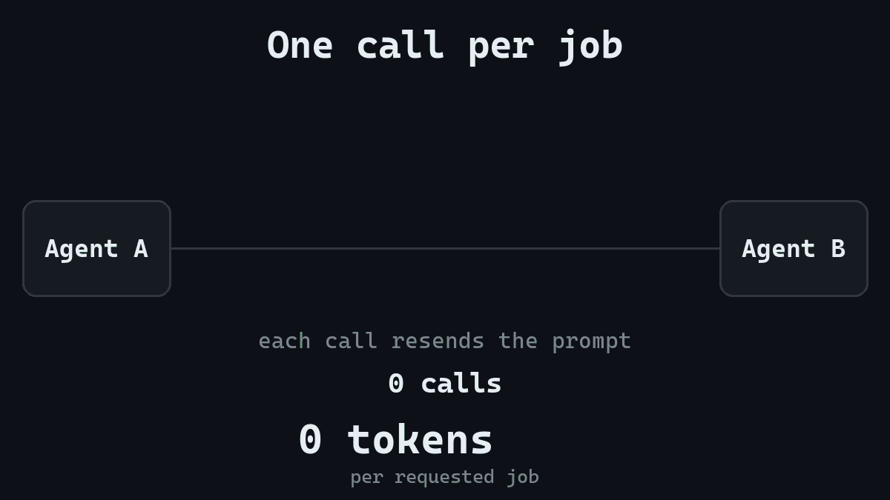
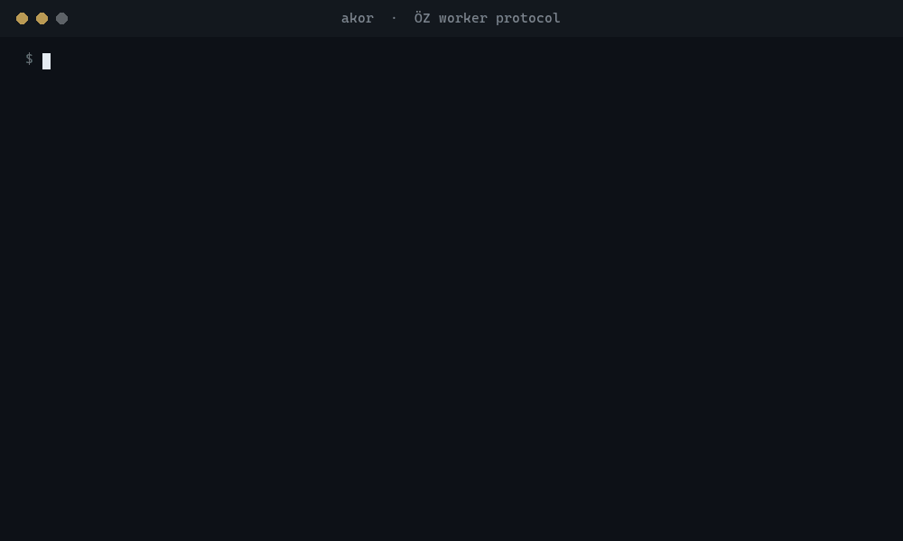

<div align="center">

# AKOR

### Batch, check and account for AI agent work: fewer model calls, fewer tokens, every answer verified.

Your agents keep repeating themselves on every call. AKOR stops you paying for it.





**31 times fewer tokens per verified job than sending one call per job (64 jobs on Claude Sonnet 5.5), and 24 times faster. Pooling four agents' jobs into one call: 40% fewer tokens. Against a JSON format that repeats each job's instruction, 41% to 43% fewer on Sonnet 5.5, Opus 5.5 and Fable 5.1. 91 of 91 replies accepted on the first try.**

<sub>Attribution: most of the 31x gap comes from batching, not from the language. Sending 64 jobs in one call instead of 64 calls removes the repeated prompt, CLI overhead and reference material, whatever the reply format. Counted per requested job instead of per verified job, so failed per-job calls do not shrink the denominator, the gap is 22x. The same test on Opus 5.5, Haiku 5.5 and Fable 5.1 gives 27x, 20x and 25x per requested job. [Pilot results](docs/design/brainstorm-2026-10-22/pilot-results.md), [four models](docs/design/direction-2026-10-26/results-5.md).</sub>

```bash
pip install git+https://github.com/canerganis/akor
```

[Try it in 60 seconds](#try-it-in-60-seconds) · [Results](#results) · [How it works](#how-it-works) · [FAQ](#faq)

If AKOR saves you tokens, a star helps other people find it.

</div>

## The 30-second version

AKOR is a compact message language and a small runtime for agent-to-agent work. Agents send jobs in a short,
indexed format instead of verbose JSON, and get back one checked record per job: many jobs per call instead of one,
shared context written once, and nothing delivered until it passes the check.

**The problem.** Multi-agent pipelines pay again and again for the same thing: every call resends the rules, the
context and a verbose reply format, and one malformed answer forces a retry.

**The fix.** AKOR packs 64 ready jobs into one call. The goal, each operation and each shared input are written
once, and jobs point at them by index. Reads, tests and status events never touch a model. The model answers one
short record per job, and the host checks the whole reply before it delivers anything.

**The proof.** Live, preregistered tests on billed tokens, with hidden reasoning and failed calls counted, against
two baselines: one plain JSON call per job, the way most pipelines send work, and a plain JSON format carrying the
same 64 jobs in one call, which isolates what the format itself adds. Nothing in the reply is repaired, so every
correct job is really correct.



## Who it is for

- You run **several agents or many small model tasks** (reviews, extractions, checks, triage) and the token bill or
  the rate limit is what stops you from doing more.
- You use **Claude through `claude -p`** and want batching, retries, a durable queue and a cost ledger without
  writing them yourself.
- You care about **numbers you can audit**: every call is logged with tokens, time and validation.

If you send one prompt at a time and wait for each answer, AKOR will not save you anything; savings start at a few
dozen jobs per call.

## Try it in 60 seconds

```bash
pip install git+https://github.com/canerganis/akor
oz demo ./demo                    # model-free end-to-end run: queue, packet, reply, validation
oz status --workspace ./demo
```



**With a real model.** The bundled adapter runs each packet through your existing `claude -p` login. No API key.

```bash
git clone https://github.com/canerganis/akor && cd akor && pip install .
oz init team --goal "Review the patch" --kind patch --source fix.diff --procedure checks.txt
oz send V --id review --workspace team                     # queue a job (read, audit, test)
oz plan --show-prompt --workspace team                     # see exactly what the model will receive
oz run --adapter examples/claude_adapter.json --workspace team --min-batch 32 --max-wait 30
oz status --workspace team
```

`--min-batch` and `--max-wait` let small jobs wait briefly for a bigger, cheaper call. Any program that reads one JSON
request on stdin and prints one JSON reply can be an adapter; see [`USAGE.md`](USAGE.md).



## What AKOR does differently

**It turns many calls into one, and writes every instruction once, and proves it.** 64 jobs travel in one call.
The goal, each operation and each shared input are written once; jobs point at them by index. Against a JSON
format that spells out each job's instruction in full, Claude Sonnet 5.5 used 40.7% fewer tokens per verified job
on the same batch, Opus 5.5 42.8%, Fable 5.1 40.6%, Haiku 5.5 30.8%, and all four answered faster.

**Every number is a billed number.** Most token-saving claims count tokens with a tokenizer and stop there. AKOR's
counts are what the provider billed: prompt, CLI overhead, visible answer and hidden reasoning, with failed calls
included. Thresholds, call budgets and data were frozen and hashed before the first call of every test.

**Nothing is repaired.** No quote fixing, no stripping of chatter, no rescue of half-broken lines. A reply is either
exactly right or rejected. On the final wire, 91 of 91 Claude replies were accepted on the first try.

**Small fixes for real failure modes.** A model would sometimes slip on the very first character after it finished
thinking, and one wrong bracket cost a whole batch. The fix is a six-character header line, `OZ/1g`, that costs 0.2%.
An ambiguous job ("an array holding one pair") produced a flat answer once; now result shapes are stated with a
literal example.

**Deterministic work never reaches a model.** Reads, test requests and status events run on the host. A batch made only
of such work finishes with zero model calls.

**Light.** Standard-library Python, a SQLite queue with resume, a ledger of every call, and no API key: it runs on the
`claude -p` login you already have.

## Results



On a live, pre-registered benchmark where every job is checked by a deterministic oracle, AKOR used
**41% to 43% fewer total tokens per verified job** than plain JSON carrying the same 64 jobs in one call, on Claude Sonnet 5.5,
Opus 5.5 and Fable 5.1 with 64 jobs per call, and 31% on Haiku 5.5, with every reply accepted on the first try and every job
correct. Haiku saves less because it thinks at length in both formats (about 6,000 output tokens per call), and AKOR only
shrinks what the model reads and writes, not how long it thinks.

| 64 jobs per call | Calls | Replies accepted | Correct jobs | Tokens per call | Median time | Tokens per verified job |
|---|---:|---:|---:|---:|---:|---:|
| Sonnet 5.5, plain JSON | 5 | 5/5 | 320/320 | 9,387 | 13.8 s | 146.7 |
| Sonnet 5.5, AKOR | 20 | **20/20** | **1280/1280** | **5,568** | **12.5 s** | **87.0 (-40.7%)** |
| Opus 5.5, plain JSON | 5 | 5/5 | 319/320 | 9,235 | 17.9 s | 144.3 per requested job |
| Opus 5.5, AKOR | 5 | **5/5** | **320/320** | **5,285** | **14.0 s** | **82.6 (-42.8%)** |
| Fable 5.1, plain JSON | 5 | 5/5 | 320/320 | 9,364 | 23.4 s | 146.3 |
| Fable 5.1, AKOR | 5 | **5/5** | **320/320** | **5,562** | **18.7 s** | **86.9 (-40.6%)** |
| Haiku 5.5, plain JSON | 5 | 5/5 | 320/320 | 13,140 | 21.0 s | 205.3 |
| Haiku 5.5, AKOR | 5 | **5/5** | **320/320** | **9,095** | **18.5 s** | **142.1 (-30.8%)** |

The plain JSON baseline is the project's earlier 0.8 format: shared refs written once, each job's instruction
written out in full, and replies as `{"results":[["ID",status,"text"],...]}`. A prompt that states a shared
instruction once captures much of the same saving (see What drives the cost).

Tokens are everything that was billed: the prompt, the CLI's own fixed overhead (about 950 tokens per call), the
visible answer and hidden reasoning. Each AKOR call was paired with a plain JSON call on the same data; failed calls
count in the cost.

The same wire was then checked on other models for breakage (no paired baseline there, so no savings claim):

| Model, jobs per call | Calls | Replies accepted | Correct jobs | Tokens per call | Median time |
|---|---:|---:|---:|---:|---:|
| Haiku 5.5, 64 | 10 | 10/10 | 640/640 | 9,267 | 20.3 s |
| Fable 5.1, 64 | 5 | 5/5 | 320/320 | 5,480 | 19.5 s |
| Sonnet 5.5, 32 | 5 | 5/5 | 160/160 | 3,891 | 7.0 s |

Plus five stress packets per model whose results are all empty arrays, scalars, objects, nested arrays or
genuine job failures. Across all 91 Claude calls on the final wire, the parser accepted every reply. Haiku 5.5
thinks much longer on this wire than Sonnet (up to 10k output tokens per 64-job packet), so it is not the cheaper
model here. Raw data, manifests and the harness are in [`bench/`](bench/); every decision is in [`docs/design/`](docs/design/).

## Compared with one subagent per job

The same 64 small jobs on Claude Sonnet 5.5, run four ways, preregistered, strict oracles, every billed token counted
including subagents ([results](docs/design/brainstorm-2026-10-22/pilot-results.md)):

| 64 jobs, 3 seeds | Correct jobs | Tokens per verified job | Median time |
|---|---:|---:|---:|
| One subagent per job | 188/192 | 7,931 | 105 s |
| One plain JSON call per job | 139/192 | 2,834 | 491 s (sequential) |
| One plain JSON call with all jobs | 192/192 | 151.1 | 21 s |
| **One AKOR call with all jobs** | **192/192** | **91.6** | **20 s** |



Most of that gap is batching, not the language: AKOR's own format adds about 39% over one batched plain JSON call at
64 jobs (10% to 18% at 16). A caller agent that hands the jobs to `oz do` instead of spawning subagents spends 9 to 10
times fewer tokens ([arm K](docs/design/foundation-2026-10-23/arm-k-results.md)); with the same model, a caller that can
do the jobs itself in one reply is cheaper still ([caller-cost results](docs/design/caller-cost-2026-10-23/results.md)).

## What drives the cost of agent work

In October 2026 we tested AKOR against stronger baselines to find out where the savings really come from: a
competent direct `claude -p` call, a plain shared queue, and plain JSON at default and high effort, all on Sonnet
5.5, every answer checked by an independent evaluator, every pair repeated in reversed order
([report](docs/design/direction-2026-10-26/MORNING-REPORT.md)).

**The number of calls is the main lever.** A near-empty `claude -p` call reported 1,916 input tokens in our probe,
before any work. For small jobs that fixed cost dominates, which is why batching gives the large wins above.

**Pooling work from several agents saves about 40%.** Four producers whose 32 jobs arrived together used about 40%
fewer tokens in one pooled call than in four separate calls, at similar wall time
([results](docs/design/direction-2026-10-26/results-3.md)). Spread over a few hundred milliseconds, pooling still
saved 40% but added up to 25% latency and missed our accuracy bar by one or two answers in 32, so the pooling runtime
(`akor_pool.py`) stays experimental ([results](docs/design/direction-2026-10-26/results-4.md)).

**The compact format pays off against prompts that repeat themselves.** Its measured 41% to 43% came from writing
each instruction once instead of once per job, and from a shorter reply. Against a plain JSON prompt that already
states the instruction once, on reading comprehension and code repair jobs, it gave no gain
([results](docs/design/direction-2026-10-26/results-2.md), [results](docs/design/direction-2026-10-26/results-4.md)).

**For one coherent task, one call is the baseline to beat.** On a code repair package, a single well-written direct
call beat our multi-stage executor (1.4 to 1.6 times fewer tokens), because the executor split the work into two
serial calls ([results](docs/design/direction-2026-10-26/results-1.md)). The executor's strength is verified delivery
through crashes, stale inputs and repeats, not lower cost on a single task.

## Supported models

This release is qualified for the tested Claude configurations only: `claude-sonnet-5-5` (32 and 64 jobs per
call), `claude-opus-5-5`, `claude-haiku-5-5` and `claude-fable-5-1` (64 jobs per call), all through `claude -p` at
default effort. Opus was added in its own preregistered run ([`docs/design/stage-1g-opus.md`](docs/design/stage-1g-opus.md)).
Other models are not qualified yet. Scope record:
[`docs/design/stage-1g-release-scope.md`](docs/design/stage-1g-release-scope.md).

## How it works

| | |
|---|---|
| **One call, many jobs** | Ready jobs are packed into one packet (64 by default). The goal, each operation and each shared input are written once, not once per job; jobs refer to them by index. `--min-batch` and `--max-wait` let small jobs wait briefly for a bigger, cheaper call. |
| **Deterministic work stays on the host** | Reading, test requests and status events never reach a model. A batch made only of such work completes with zero model calls. |
| **One record per job, keyed by ID** | The model answers `OZ/1g`, then `{"job_id":result}` per job, or `["job_id","error",code,message]` for a job it cannot do. Results bind to IDs, never to line positions. |
| **Strict, atomic acceptance** | The whole reply is checked before anything is delivered: header, one record per expected ID, no extras, strict JSON. Nothing is repaired. A malformed reply sends its batch back once (two attempts by default); a valid error record fails only its own job. |
| **Inputs are data, never instructions** | Shared inputs travel in `refs`, which the worker is told are data. The worker has no tools and may not claim execution or verification. |
| **Durable queue** | SQLite inbox with dependencies, retries, leases and resume. Exactly-once insertion, at-least-once delivery. |
| **Every call on the books** | An append-only ledger (`calls.jsonl`) records tokens, cache use, time, validation and retries for each call. |
| **Provider-neutral** | Adapters are plain stdin/stdout programs. This release is qualified on `claude -p` logins. |
| **Small core** | Python 3.10+, standard library only. `tiktoken` is optional for token counting. |

A packet body and its reply (from [`docs/design/stage-1g-astra.md`](docs/design/stage-1g-astra.md), shortened):

```json
{"v":"1g","goal":"Prepare an evidence-limited inspection handoff. The numerical acceptance interval is [12.48,12.52] mm, inclusive.",
 "ops":["Return a compact JSON array of strings containing the ref's length, uncertainty, n, method, basis, physical_validation, in that order.",
        "Return inside if the entire length +/- uncertainty interval lies within the goal's acceptance interval; outside otherwise."],
 "refs":["length=12.53 mm; uncertainty=0.01 mm; n=4; method=micrometer; basis=unknown; physical_validation=not_claimed",
         "length=12.54 mm; uncertainty=0.02 mm; n=5; method=micrometer; basis=unknown; physical_validation=not_claimed"],
 "jobs":[[0,["e1",0],["e2",1]],[1,["v1",0],["v2",1]]]}
```

```text
OZ/1g
{"e1":["12.53 mm","0.01 mm","4","micrometer","unknown","not_claimed"]}
{"e2":["12.54 mm","0.02 mm","5","micrometer","unknown","not_claimed"]}
{"v1":"outside"}
{"v2":"outside"}
```

## How it was measured

Every change to the wire went through the same gate: a plan, thresholds and call budget frozen and hashed before the
first call, fresh records every repetition, deterministic oracles for every job, strict validation as in the
product, and failed calls counted in the cost. Every design decision and test round is recorded in
[`docs/design/`](docs/design/).

That gate caught real problems along the way, and they are on record:

- An earlier reply format (stage 1f) lost 3 of 3 live calls to a slip in the first visible characters: typographic
  quotes, or a result array flattened into its record. The fix was a separate record shape per success
  (`{"id":value}`) and a fixed header line before the first record.
- A model alias that silently pointed at an older model, and a test harness that repaired replies the product
  would reject.
- Two defects in our own stress packets: jobs that needed outside facts under a goal that said "answer from the
  supplied refs only", and one job whose wording allowed a flat or a nested reading. The wire carried every one of
  those answers correctly; the packets were fixed, re-approved and re-run. Two authoring rules came out of it:
  state the result shape, with a literal example when nesting matters, and let the goal say whether a job may use
  knowledge that is not in its refs.

The full specification is in [`OZ9.md`](OZ9.md).

## Limits

- Savings come from batching. With 1 to 4 jobs per call there is no gain; the fixed per-call overhead dominates.
- The format's own saving is measured against a format that repeats each job's instruction. Against a plain JSON
  prompt that states the instruction once, it matched at best in our tests, and when the model reasoned more on the
  compact wire it was slower.
- The paired savings figures are for Sonnet 5.5, Opus 5.5, Fable 5.1 and Haiku 5.5 at 64 jobs on one task family with
  oracles; your workload may differ, and [`bench/`](bench/) lets you measure it. Models that think at length save less,
  because thinking tokens do not shrink with the packet.
- Acceptance is all or nothing per reply: one malformed line costs a retry of the whole batch. On the final wire
  that did not happen in 91 calls, which bounds the per-call failure rate (about 3.3% at 95% confidence), it does
  not prove it is zero.
- Only the Claude configurations listed under Supported models are qualified for this wire.
- The classification operation in the benchmark workload rarely produces an "inside" answer (none in the 64-job
  pilot), so its correctness figures say little about inclusive-boundary cases. In the step 4 workflow, where half the
  cases are boundaries, Sonnet 5.5 misclassified four of them, each in a call that used no hidden reasoning; per-job host
  checks caught every one before delivery ([step 4 results](docs/design/step4-2026-10-23/g3b/results.md)).
- Authoring rule that follows from it: a step the host can compute exactly from checked values stays on the host
  ([decision](docs/design/boundary-adoption-2026-10-23/decision-host-classify.md)).

## Related work

AKOR combines known ideas and measures them strictly. Batch prompting ([Cheng et al. 2023](https://arxiv.org/abs/2301.08721))
showed large savings from answering several samples in one call. LLMCompiler ([Kim et al. 2024](https://arxiv.org/abs/2312.04511))
plans function calls as a dependency graph. LDP ([2026](https://arxiv.org/html/2603.08852v1)) and BabelTele
([2026](https://arxiv.org/abs/2606.19857)) report 37% to 44% fewer tokens from structured or compressed agent messages.
[Protocol Compression Changes Which Party Pays](https://arxiv.org/abs/2609.06129) shows that compression can raise total
cost through parsing failures, which is why every AKOR result counts failed calls. These works use different
baselines, so their numbers are not directly comparable.

## Documentation

- [`OZ9.md`](OZ9.md): the protocol and host design, normative.
- [`docs/design/`](docs/design/): every wire stage, review, debate and live evidence, in order.
- [`USAGE.md`](USAGE.md): command-line guide.
- [`bench/`](bench/): live measurement harness, raw results and measurement kits.
- [`docs/HISTORY.md`](docs/HISTORY.md): how the protocol evolved.

## FAQ

**Is this another agent framework?** No. AKOR is the layer between your agents and the model call: a queue, a packet
format, a strict reply check and a cost ledger. Your agents keep their own logic.

**Do I need an API key?** No. It runs on the `claude -p` login you already have. Adapters are plain stdin/stdout
programs, so other runtimes can be connected.

**Which models are supported?** Claude Sonnet 5.5, Opus 5.5, Fable 5.1 and Haiku 5.5 through `claude -p` at default
effort, tested at 32 and 64 jobs per call. Other models are not qualified yet.

**What happens when the model gets something wrong?** A malformed reply is rejected as a whole and the batch is
retried (two attempts by default). A job the model cannot do comes back as an explicit error record and fails only
that job. Nothing is silently repaired.

**How do I check the numbers myself?** Raw replies, manifests and the harness are in [`bench/`](bench/);
after `pip install ".[benchmark]"`, `python bench/selftest.py` checks the scoring, and `bench/live/` reruns the live tests on your own login.

**Why is Haiku's saving smaller?** Haiku thinks at length in both formats. AKOR shrinks what the model reads and
writes, not how long it thinks.

## Roadmap

- More task families in the public benchmark (code review, log triage) next to the current extraction tasks.
- Done: a comparison against one call per job and one subagent per job (see above).
- Done in the runtime: a resumable executor for dependent multi-step work with per-job checks, judged on a 20-step
  real workflow where the model writes code and the host verifies it in three tiers
  ([O1 result](docs/design/o1-real-workflow-2026-10-23/results.md)).
- More models and runtimes, each added only after its own preregistered qualification.

Issues and pull requests are welcome.

## Author

Built by [@canerganis](https://github.com/canerganis). Questions and ideas: open an issue.

## License

MIT, see [`LICENSE`](LICENSE).
